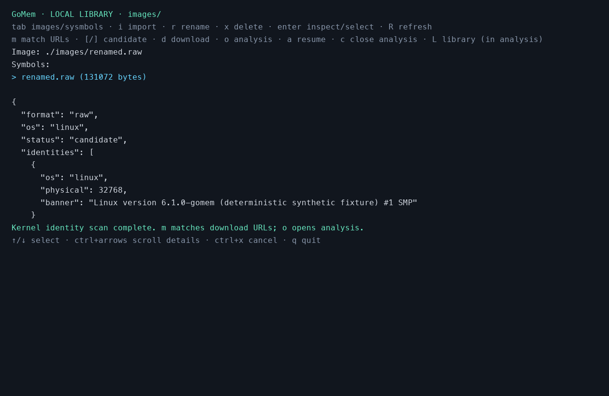

# 镜像识别、符号匹配与本地库

无需预先提供 OS、DTB 或符号表，即可扫描镜像中的内核身份：

```sh
bin/gomem images inspect memory.raw
bin/gomem symbols match memory.raw
bin/gomem symbols match memory.raw --download
bin/gomem tui --library-dir . --case .cache/my-case
```

`images inspect` 输出镜像格式、系统候选、物理地址，以及 Linux 完整 banner 或 Windows 内核 PDB 名称、GUID、Age。复用原生物理内存映射，支持 raw、LiME、AVML、受支持的 ELF core 和 Windows crash dump；不会把容器头当成普通 RAM 扫描，不需要 Python 或 Volatility。

`symbols match` 自动匹配地址，默认不下载；`--download` 对每个候选显示 URL 并询问 `[y/N]`，只有输入 `y` 或 `yes` 才下载。EOF、空输入及其他回答均跳过下载。`--offline` 禁止远程目录查询和下载；Windows URL 可以根据已知 PDB 身份在本地生成。

## TUI 操作

`gomem tui` 可在没有 `--image` 的情况下启动本地库。根目录由 `--library-dir` 指定，默认当前工作目录，镜像和符号分别放在 `images/`、`sysmbols/`。后者拼写按本地库接口保留，与现有案件的 `CASE/symbols/` 目录独立。两个本地库目录均在 Git 忽略规则内。

| 按键 | 行为 |
| --- | --- |
| `tab` | 切换镜像与符号表列表 |
| `↑/↓` | 选择文件 |
| `i` | 输入路径，将本地文件复制到当前库；保留原文件 |
| `r` | 重命名所选本地文件；不覆盖已有文件 |
| `x` | 删除所选本地副本；需再次按 `y` 确认 |
| `enter` | 扫描并选中镜像；或检查并选中本地符号表 |
| `m` | 根据已扫描的内核身份查询精确符号地址 |
| `[` / `]` | 在多个下载候选间选择 |
| `d` | 显示所选下载地址；再次按 `y` 才下载 |
| `o` | 使用所选镜像和本地符号打开分析界面 |
| `L` | 从分析界面返回本地库（输入命令、参数或导入路径时保留文本输入） |
| `a` / `c` | 恢复 / 关闭已有分析会话 |
| `R` | 刷新文件列表 |
| `ctrl+方向键` | 纵向或横向滚动身份、下载地址等详细信息 |
| `ctrl+x` | 取消当前扫描、导入或下载 |
| `q` | 退出 |

选择另一镜像会清除此前扫描结果、下载候选和符号选择。`o` 在只有一个身份候选时，可以自动选择库内身份完全匹配的表；多个不同内容的表匹配时需手动选择。选择符号表时也核验其身份是否与所选镜像的候选一致。损坏的本地表会明确报错，不会静默从匹配范围排除。

分析界面保留平台能力筛选、按当前镜像筛选历史任务，以及 `i` 打开的路径/目录/最近镜像导入器。导入器更换镜像后，本地库同步当前引擎与文件保护状态。分析仍使用现有的引擎、证据库与分页功能，可继续传入 `--dtb`、`--kernel-base`、`--kernel-slide`、`--case` 等参数。管理器打开分析时禁用隐式网络下载；符号下载统一通过上述确认流程进行。已打开分析的镜像和符号表禁止在库内重命名、删除；先按 `c` 关闭会话。



## 匹配与下载规则

Linux 使用 [Abyss-W4tcher/volatility3-symbols](https://github.com/Abyss-W4tcher/volatility3-symbols) 的 `banners/banners_plain.json`，只按完整 banner 匹配，查询时去除目录中省略的末尾换行。内核版本相同、编译器或构建信息不同不会视为匹配。兼容目录中的仓库相对路径及 GitHub release asset URL。该仓库提供 Linux/macOS 表，没有 Windows 表；此功能不处理 macOS 身份匹配。

Windows 只采集已知内核 PDB 名称的 RSDS 记录，生成 Microsoft 符号服务器的精确 GUID/Age 地址。确认下载后复用原生 PDB 解析与缓存校验，导出 ISF 到 `sysmbols/`；下载过程的 PDB 缓存放在该目录下隐藏的 `.pdb-cache/`。

Linux 下载限制为 128 MiB，保留原始 JSON/gzip/xz 文件，解压与解析继续受既有符号解析限制保护。发布前核验表中的完整 banner；Windows 核验 PDB 身份。下载结果使用内容摘要命名，重复下载不会覆盖已有表。上游目录未提供预期 SHA-256，因此身份校验不等于独立的来源认证；文件名摘要用于标识已下载内容。

导入和下载先写隐藏临时文件，通过不覆盖目标的方式发布；取消、解析失败、身份不匹配或其他错误均清理临时文件。管理操作拒绝路径穿越、符号链接库目录和非普通文件。列表只显示库目录第一层普通文件，ZIP 包等作为单个文件管理；不会递归遍历隐藏缓存。

## 证据边界与验证

扫描得到的是内核身份线索，不能从一般内存镜像直接恢复完整调试符号表。输出 `status=candidate` 表示单个候选，`ambiguous` 表示多个不同身份，`unavailable` 表示没有身份线索；Windows crash 头可独立确定系统类别，缺少 PDB 时标为 `header-only`。物理内存可能保留旧 banner、缓存文件或 RSDS 记录，这些候选不证明当前活动内核。分析引擎继续在目标虚拟地址核验符号身份。

受支持的容器也可能缺少身份所在页面；未发现标识不代表系统属于另一 OS。实际读错误、未映射页面、取消与格式不支持会返回错误；不会转成空结果。损坏、压缩或不受支持的采集格式不能保证识别。通用 Windows raw DTB/基址发现、Linux ARM 地址翻译和任意内核的自动地址空间配置不在本次能力范围内。

新增验证位于 `internal/library/library_test.go`、`internal/tui/library_test.go` 和 `internal/cli/images_test.go`，覆盖跨扫描边界、未知/歧义身份、读失败、取消、精确匹配、release URL、离线、拒绝下载、身份不匹配、不覆盖文件、路径限制、保留原镜像以及关闭/重开分析会话。使用确定性合成镜像及模拟 HTTPS 响应；不构成官方真实镜像语料的发布验收。预览图来自测试模型的实际文本输出渲染。
